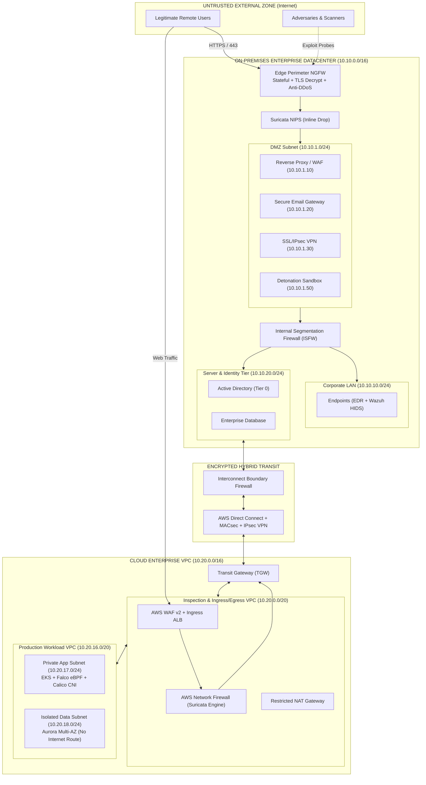

# Layered Defense Blueprint for Hybrid Cloud Networks

[](LICENSE)
[]()
[]()

A comprehensive, production-grade cybersecurity architecture and defense blueprint designed to secure hybrid enterprise networks across on-premises datacenters and cloud VPCs. This repository integrates stateful & application-layer firewall strategies, network and host intrusion detection/prevention systems (IDS/IPS), multi-tier malware countermeasures, and a quantitative risk assessment matrix mapped to MITRE ATT&CK.

---

## 📁 Repository Structure

```text
├── index.html                          # Interactive SOC Security Dashboard & Topology Simulator (Web UI)
├── HYBRID_CLOUD_DEFENSE_BLUEPRINT.md   # Master defense blueprint document (detailed specs, tables & analysis)
├── hybrid_cloud_topology.drawio        # Visual topology diagram (open directly in draw.io / diagrams.net)
├── firewall_policy.yaml                # Declarative firewall rules across all 5 boundaries (IaC ready)
├── suricata_rules.rules                # Production Suricata 7.x signatures (Edge, IMDS SSRF, Lateral, C2)
└── README.md                           # Repository overview and navigation
```

---

## 🖥️ Interactive Web UI & Simulator

This repository includes a standalone, zero-dependency **SOC Command Center Dashboard** (`index.html`) featuring:
1. **Interactive Traffic & Attack Simulator**: Trace packet flows and firewall blocks for Legitimate Users, Cloud SSRF, Lateral Pivots, and Ransomware.
2. **Packet Evaluation Tester**: Input Source, Destination, and Port to test which boundary rule triggers and whether traffic is allowed or dropped.
3. **Live IDS/IPS Telemetry Console**: Real-time event simulation showing Suricata 7.x and Wazuh alerts.
4. **Interactive Risk Heatmap**: Filter threats, likelihood, impact, and mitigation controls dynamically.

> Simply open `index.html` directly in any web browser, or enable **GitHub Pages** (Settings > Pages > Branch: `main`) for instant live hosting!

---

## 🏛️ Architecture Overview

The blueprint partitions hybrid enterprise networks into six security domains connected via an encrypted private transit trunk:



---

## 🛡️ Core Security Capabilities

### 1. Multi-Boundary Firewall Rules
- **Boundary 1 (Perimeter NGFW)**: Stateful packet filtering, TLS 1.3 decryption, threat prevention, and Geo-IP shedding at the edge.
- **Boundary 2 (DMZ to Internal ISFW)**: Strict default-deny isolation; terminates proxy connections, enforces LDAPS for DMZ authentication, and blocks direct DMZ-to-Core database access.
- **Boundary 3 (Hybrid Interconnect Firewall)**: Inspects east-west traffic between on-premises and AWS Direct Connect; drops default route BGP propagation and isolates on-prem workstations from cloud database subnets.
- **Boundary 4 (Cloud Central Inspection VPC)**: AWS WAF v2 (OWASP Top 10 + rate limiting) and AWS Network Firewall (Suricata engine) inspecting all inbound ingress and outbound egress domains.
- **Boundary 5 (Cloud East-West Microsegmentation)**: Stateful AWS Security Groups with reference-based chaining (ALB $\rightarrow$ App $\rightarrow$ DB) and Calico CNI NetworkPolicies preventing lateral pod-to-pod pivoting.

*Defined in detail in [HYBRID_CLOUD_DEFENSE_BLUEPRINT.md](HYBRID_CLOUD_DEFENSE_BLUEPRINT.md) and declaratively in [firewall_policy.yaml](firewall_policy.yaml).*

### 2. Synchronized IDS/IPS Architecture
- **Perimeter Edge (Inline NIPS)**: Suricata 7.x hardware appliance dropping exploit signatures (Log4Shell, Spring4Shell, CVEs) before reaching DMZ hosts.
- **Internal Core Switch (Passive NIDS)**: Zeek & Suricata tapping core switches via SPAN/TAP ports for protocol extraction and lateral movement detection (BloodHound, SharpHound, Nmap).
- **Cloud Transit Hub (Inline & Mirror)**: AWS Network Firewall filtering all traffic passing through the Transit Gateway (TGW).
- **Host & Workload Tier (HIDS / EDR)**: Wazuh HIDS agents + CrowdStrike Falcon on endpoints and servers, paired with Falco eBPF runtime security on Kubernetes pods to detect in-memory and kernel syscall anomalies.

*Signatures implemented in [suricata_rules.rules](suricata_rules.rules).*

### 3. Multi-Tier Malware Defense Strategy
- **Pre-Execution Email Defense**: Secure Email Gateway enforcing SPF, DKIM, and DMARC (`p=reject`), time-of-click URL rewriting, Content Disarm & Reconstruction (CDR), and anti-quishing computer vision.
- **Zero-Day Dynamic Sandboxing**: Hybrid detonation chambers (on-prem bare-metal + cloud WildFire) executing files in simulated environments with anti-evasion instrumentation and automated IOC push to perimeter firewalls within 60 seconds.
- **Endpoint Protection (EDR/XDR)**: Machine-learning heuristic NGAV, AMSI memory scanning, LSASS protection via Windows Credential Guard, and automated network isolation.
- **Lateral Movement Containment**: 3-tier Active Directory isolation (Tier 0/1/2), client-to-client workstation traffic blocking, and LAPS password rotation.

### 4. Threat & Risk Assessment Matrix

| Threat | Vulnerability / Attack Vector | MITRE ATT&CK | Inherent Risk | Layered Blueprint Mitigation | Residual Risk |
| :--- | :--- | :--- | :---: | :--- | :---: |
| **THREAT-01** | **Lateral Movement via Hybrid Interconnect** | T1021.002, T1078 | **20 (Critical)** | Dedicated Boundary FW (`FW-HYB-06`), AWS Network Firewall, Database Subnet isolation | **4 (Low)** |
| **THREAT-02** | **Ransomware via Weaponized Attachment** | T1566.001, T1486 | **25 (Critical)** | SEG DMARC `p=reject`, dynamic sandbox detonation, EDR behavioral kill-switch | **3 (Low)** |
| **THREAT-03** | **SSRF Leading to Cloud IMDS Credential Theft** | T1190, T1552.005 | **20 (Critical)** | AWS WAF v2 (`WAF-CLD-01`), mandatory IMDSv2, Falco eBPF syscall alerts | **2 (Low)** |
| **THREAT-04** | **Zero-Day Vulnerability in Perimeter Gateway** | T1190, T1068 | **15 (Critical)** | Geo-IP shedding, OOB management isolation, inline NIPS protocol anomaly inspection | **6 (Medium)** |
| **THREAT-05** | **Compromised CI/CD Container Backdoor** | T1195.002, T1610 | **12 (High)** | Container image scanning, read-only root filesystems, Calico egress policies, Falco runtime kill | **3 (Low)** |
| **THREAT-06** | **Kerberoasting & AD Privilege Escalation** | T1558.003, T1110 | **16 (Critical)** | Zeek/Suricata RC4 `TGS-REQ` detection, Tier 0 asset isolation, gMSA 128-char passwords | **2 (Low)** |

---

## 🚀 Getting Started & Usage

### Visualizing the Topology
1. Open [draw.io](https://app.diagrams.net) in your browser.
2. Select **File > Open From > Device...** and choose [`hybrid_cloud_topology.drawio`](hybrid_cloud_topology.drawio).
3. Inspect and edit the trust domains, network connectors, and subnet allocations.

### Deploying Suricata Rules
Copy `suricata_rules.rules` to your Suricata rules directory:
```bash
sudo cp suricata_rules.rules /etc/suricata/rules/hybrid_defense.rules
# Add hybrid_defense.rules to your /etc/suricata/suricata.yaml rule-files list
sudo suricata -T -c /etc/suricata/suricata.yaml -v
```

### Applying Firewall Policies
The declarative definitions in `firewall_policy.yaml` can be referenced by CI/CD pipelines deploying:
- AWS Network Firewall Rule Groups (`AWS::NetworkFirewall::RuleGroup`)
- Palo Alto PAN-OS XML / REST API configurations
- pfSense / Fortinet rule definitions

---

## 📜 License
This project is open-source under the MIT License.
